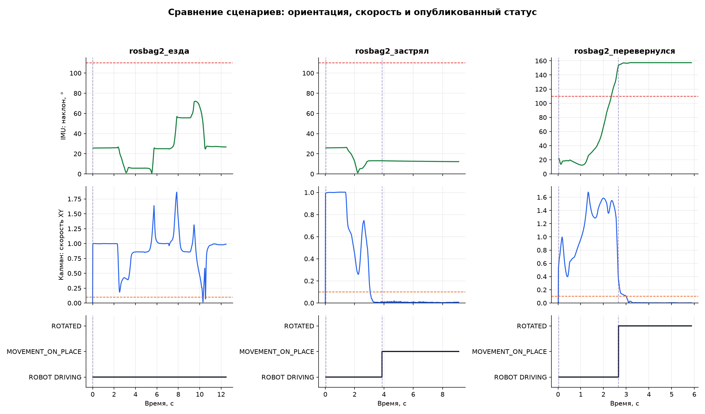
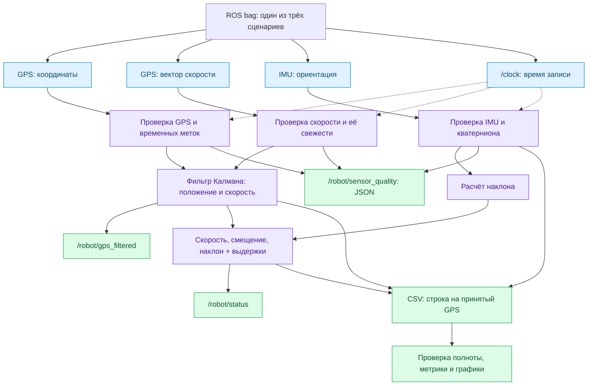
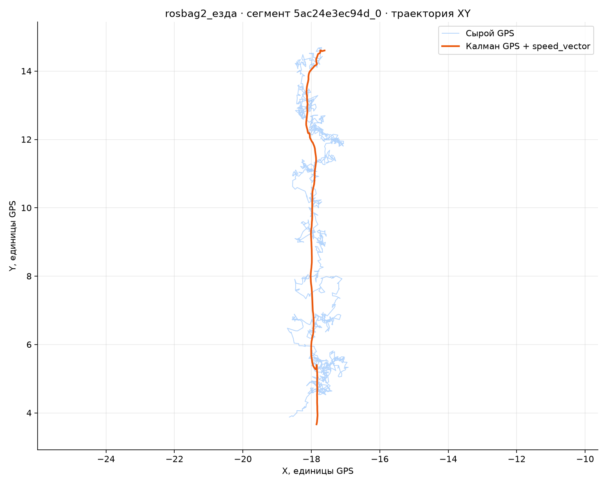
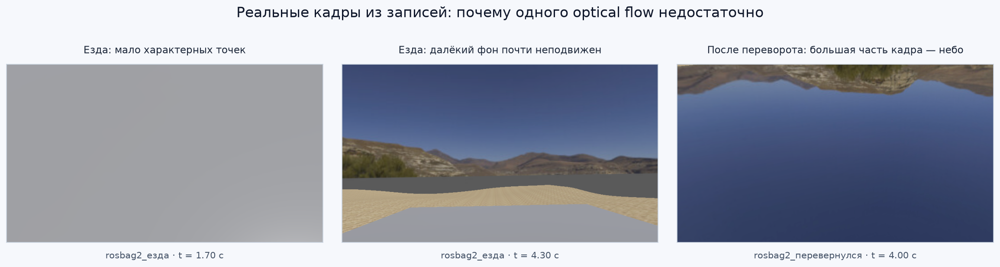

# RoboMower: фильтрация GPS и определение состояния

**Тестовое задание · ROS 2 Jazzy · Python · 3 сценария**

В этом проекте я сделал ROS 2-ноду, которая сглаживает GPS и определяет, что сейчас происходит с роботом: он едет, застревает или перевернулся. Проверял решение на трёх записях из симулятора — с нормальной ездой, застреванием и переворотом.

Мне хотелось получить понятное решение: чтобы можно было запустить его одной командой, посмотреть графики и разобраться, почему алгоритм выдал конкретное состояние. Поэтому отдельно проверяется качество датчиков, а результаты сохраняются вместе с исходными измерениями.

```bash
bash start.sh
```



**Навигация:** [запуск](#quick-start) · [пайплайн](#pipeline) · [алгоритм](#algorithm) · [результаты](#results) · [эксперименты с камерой](#vision) · [структура](#structure)

<a id="task"></a>
## Что требовалось сделать

Полное условие находится в [Описание.txt](./Описание.txt). Основные задачи:

- Фильтровать шумные координаты GPS и публиковать результат в `/robot/gps_filtered`.
- Определять состояние робота и публиковать его в `/robot/status`.
- Оформить решение как ROS 2-пакет и показать результаты на графиках.

| Состояние в топике | Как его трактует алгоритм |
| --- | --- |
| `ROBOT DRIVING` | Движение по оценке скорости и изменения положения |
| `MOVEMENT_ON_PLACE` | Низкая скорость и небольшое смещение в течение заданного времени |
| `ROTATED` | Устойчивый большой наклон по IMU; это состояние имеет приоритет |

Название `MOVEMENT_ON_PLACE` оставлено по условию задания. Без команды движения или энкодеров нельзя уверенно отличить застревание от обычной остановки. Здесь определяется отсутствие заметного перемещения, а не его причина.

<a id="quick-start"></a>
## Быстрый запуск

### Что нужно заранее

Нужны **Ubuntu 24.04 и установленный ROS 2 Jazzy**. Я запускал проект через WSL 2. Скрипт ожидает ROS в `/opt/ros/jazzy/setup.bash`; сам ROS он не устанавливает.

Положите три исходные записи рядом со скриптом. В каждой папке записи должны быть `metadata.yaml` и соответствующие файлы `.db3`. Большие записи исключены из Git, поэтому после клонирования их нужно добавить отдельно.

```text
roboticks-testovoe/
├── start.sh
├── ros2_ws/
├── rosbag2_езда/
├── rosbag2_застрял/
└── rosbag2_перевернулся/
```

### Одна команда из корня проекта
Для моего расположения проекта полный переход и запуск выглядят так:

```bash
cd /mnt/c/Users/User/Desktop/roboticks-testovoe
bash start.sh
```

Скрипт сам подключает ROS, устанавливает недостающие зависимости, собирает пакет через `colcon`, подключает сборку и последовательно проверяет все три записи. Пароль `sudo` понадобится, только если нужно установить пакеты.

По умолчанию записи проигрываются на скорости `0.5`, чтобы оставить запас на доставку и обработку сообщений. Время алгоритма берётся из `/clock`, поэтому выдержки измеряются во времени записи. Скорость воспроизведения можно изменить:

```bash
RATE=1 bash start.sh
```

Перед запуском остановите другие проигрыватели записей и ноды `robot_gps_kalman` в том же ROS-домене. Скрипт проверяет конфликтующих издателей и запрещает повторный параллельный запуск. Во время проверки сохраняйте текущую папку результатов и не редактируйте работающий `start.sh`.

### Зависимости

| Зависимость | Для чего нужна | Как появляется |
| --- | --- | --- |
| ROS 2 Jazzy: `rclpy`, сообщения, `rosbag2`, `launch_ros` | Нода, топики, воспроизведение записей | Устанавливается заранее вместе с ROS |
| `python3-numpy` | Математика фильтра Калмана | Недостающий пакет устанавливает `start.sh` |
| `python3-matplotlib` | Графики и отчёт | Недостающий пакет устанавливает `start.sh` |
| `python3-colcon-common-extensions` | Сборка ROS-пакета | Недостающий пакет устанавливает `start.sh` |
| RViz 2 | Просмотр изображения камеры | Необязательный инструмент |
| OpenCV, `rosbag2_py` | Исследовательские проверки RGB | Не нужны для основного запуска |

<a id="pipeline"></a>
## Как устроен пайплайн



Основной прогон использует GPS и IMU. RGB и depth не проигрываются, чтобы тяжёлые изображения не создавали лишнюю нагрузку при проверке этих потоков.

### Входы и выходы

| Топик | Тип сообщения | Назначение |
| --- | --- | --- |
| `/RoboMowerRealistic/gps` | `geometry_msgs/msg/PointStamped` | Координаты из предоставленных записей |
| `/RoboMowerRealistic/gps/speed_vector` | `geometry_msgs/msg/Vector3` | Вектор скорости для коррекции фильтра |
| `/imu` | `sensor_msgs/msg/Imu` | Ориентация робота |
| `/clock` | `rosgraph_msgs/msg/Clock` | Симуляционное время |
| `/robot/gps` | `geometry_msgs/msg/Vector3` | Альтернативный вход GPS по интерфейсу задания |
| `/robot/gps_filtered` | `geometry_msgs/msg/Vector3` | Отфильтрованные координаты |
| `/robot/status` | `std_msgs/msg/String` | Одно из трёх состояний |
| `/robot/sensor_quality` | `std_msgs/msg/String` | JSON с пригодностью датчиков и `status_valid` |

Использовать нужно **один источник GPS**: топик записи или `/robot/gps`. Скалярный `/RoboMowerRealistic/gps/speed` дополнительно сохраняется в телеметрии, но основной алгоритм использует вектор скорости.

<a id="algorithm"></a>
## Почему алгоритм работает именно так

### Фильтрация GPS

Для каждой оси `x`, `y`, `z` фильтр Калмана оценивает положение и скорость. Между измерениями он прогнозирует движение с постоянной скоростью, затем корректирует прогноз по координатам GPS и свежему `speed_vector`. Учитывается реальный интервал между сообщениями.

Вектор скорости помогает сгладить траекторию и быстрее отреагировать на остановку. При этом он приходит от того же GPS-источника: считать его независимой проверкой GPS нельзя. Ускорение IMU в фильтр не подмешивается; параметр `accel_sigma` задаёт неопределённость модели движения.



На графике видно, что фильтр сглаживает резкие колебания исходной траектории. Эталонной траектории в данных нет, поэтому по этой картинке нельзя утверждать, насколько уменьшилась ошибка положения. Единицы координат на графиках обозначены как единицы GPS: сам `PointStamped` не подтверждает масштаб конкретного симулятора.

### Определение состояния

Наклон рассчитывается из кватерниона IMU, а движение — по горизонтальной скорости и смещению отфильтрованной позиции за последние `0.8 с`. Для переключений используются разные пороги входа и выхода — гистерезис. Он уменьшает постоянное переключение состояния около границы.

| Условие | Значение по умолчанию |
| --- | --- |
| Вход в `ROTATED` | Наклон ≥ `110°` в течение `0.30 с` |
| Выход из `ROTATED` | Наклон ≤ `95°` в течение `0.30 с` |
| Вход в `MOVEMENT_ON_PLACE` | Скорость < `0.10` в течение `0.80 с` и смещение ≤ `0.25` за это окно |
| Возобновление движения | Скорость ≥ `0.20` или смещение ≥ `0.40` при состоянии остановки |
| Допустимый возраст IMU и данных движения | `0.30 с` |

Пороги скорости и смещения заданы в шкале входных GPS-данных. Переворот имеет приоритет: неподвижный перевёрнутый робот должен оставаться `ROTATED`.

### Проверка качества данных

Перед обработкой проверяются конечность значений, временные метки и свежесть сообщений. GPS-выброс сравнивается с прогнозом с учётом неопределённости фильтра; порог отклонения по умолчанию равен `5` и не является расстоянием в метрах. Для первого измерения такая проверка невозможна: оно инициализирует фильтр.

У IMU проверяются доступность ориентации, норма кватерниона и ковариация. Некорректная ориентация сбрасывает накопленные признаки переворота. Устаревшие сообщения и дубли не заменяют свежие данные.

До первого `/clock` сообщения GPS с меткой времени и IMU ждут в ограниченной очереди, после чего проходят обычные проверки. Сообщения без собственной метки времени до запуска часов не используются. Сброс времени очищает состояние предыдущего воспроизведения.

Если свежих данных для классификации нет, нода прекращает публиковать новые состояния. Старый полученный `String` у подписчика может оставаться, поэтому актуальность нужно смотреть через `status_valid` в `/robot/sensor_quality`. Диагностика показывает `OK`, `MISSING`, `STALE`, `INVALID` или `WAITING_CLOCK`, возраст измерений и счётчики отклонений.

<a id="results"></a>
## Что получилось на трёх записях

Графики выше и таблица ниже взяты из прогона **11 октября 2026 года**, `20261011_012408_2492`. Это обработка настоящей ROS-ноды во время воспроизведения, а не только расчёт на заранее прочитанном CSV.

| Сценарий | GPS записано / ожидалось | Строки с валидным состоянием | Результат базовой проверки |
| --- | ---: | ---: | --- |
| Езда | 1193 / 1193 | 99.83% | `PASS` |
| Застревание | 874 / 874 | 99.66% | `PASS` |
| Переворот | 563 / 563 | 99.29% | `PASS` |

Все **2630 GPS-сообщений** попали в итоговую телеметрию. Несколько первых строк не имеют состояния: алгоритму нужно дождаться пригодных данных датчиков и накопить окно наблюдения.

В записи с застреванием `MOVEMENT_ON_PLACE` появился на `3.868 с`, через `0.800 с` после начала устойчиво низкой скорости. В записи с переворотом `ROTATED` появился на `2.663 с`, через `0.309 с` после первого наклона ≥ `110°`. В сценарии езды среди валидных состояний был только `ROBOT DRIVING`.

**Эти задержки отсчитываются от порогов алгоритма, а не от вручную размеченного момента события.** Доля валидных состояний показывает наличие пригодных входных данных. Это не процент правильных ответов.

`PASS` означает полноту захвата, допустимые состояния и успешные базовые проверки сценария. Он не заменяет оценку точности по независимой разметке.

### Что лежит в результатах запуска

Каждый запуск создаёт собственную папку `validation_runs/<дата_время_pid>/`:

| Файл или папка | Содержимое |
| --- | --- |
| `robot_telemetry_live_all.csv` | Исходный GPS, результат фильтра, снимки датчиков и состояние на каждом принятом GPS |
| `scenario_metrics.csv` | Полнота, валидность, задержки и проверки сценариев |
| `status_transitions.csv` | Моменты изменения состояния |
| `plots/` | Общая сводка и графики отдельных сценариев |
| `logs/` | Журналы ноды и проигрывателя записей |

Картинки в README сохранены отдельно в корне проекта, поэтому удаление старых результатов не сломает иллюстрации. Новый запуск создаст свои графики и не обновит эти примеры автоматически.

<a id="vision"></a>
## Эксперименты: почему не добавил RGB и RGB + depth

### Сначала проверил сами данные

Перед добавлением камеры я проверил форматы, временные метки, частоту кадров и содержимое depth и облаков точек. Наличие топика само по себе ещё не означает, что по нему можно оценивать движение.

| Проверка | Что обнаружилось |
| --- | --- |
| RGB во всех трёх записях | 2629 кадров, `848 × 480`, `BGRA8`, около 96 кадров/с |
| Формат и время RGB | Повреждений формата, дублей и обратного хода временных меток не обнаружено |
| RGB и IMU | Медианная разница с ближайшей меткой IMU около `2.5–2.6 мс`; максимум около `30.6 мс` |
| `CameraInfo` для RGB | Размеры и параметры стабильны; это проверка метаданных, а не доказательство точности физической калибровки |
| Depth | Во всех 2629 проверенных изображениях глубина содержит только `+Inf` |
| Облака точек | Во всех 2628 проверенных облаках нет точек с конечными координатами `x`, `y`, `z` |

Отсутствие конечных координат относится к **depth и облакам точек**, а не к GPS и не к RGB. Цветные изображения доступны и читаются нормально.

### RGB: сигнал о движении есть, но простой порог даёт ошибки

Я проверил гипотезу с характерными точками и Lucas–Kanade optical flow: находил точки, отслеживал их между кадрами и отбрасывал несогласованные треки проверкой вперёд-назад. Для эксперимента кадры уменьшались до `424 × 240`, пары выбирались примерно через `0.1 с`.

На записи с застреванием идея выглядит перспективно. При небольшом вращении медианный поток на участках движения был примерно **297 пикселей/с**, а при низкой GPS-скорости — **12 пикселей/с**. Это значения для уменьшенных кадров и выбранных треков; участки сравнивались с GPS-скоростью, а не с независимой разметкой.

Но в записи с нормальной ездой нашёлся контрпример: на участке около `3.9–4.6 с` медианный поток мог быть почти нулевым, хотя GPS показывал движение. Большинство точек попадало на далёкий фон, который визуально почти не смещался. Ближайшая поверхность давала другой сигнал, но терялась в общей медиане.



Есть и другие сложности: почти однотонные кадры дают мало точек, вращение камеры тоже создаёт optical flow, а при перевороте часть треков теряется. В записях нет `/tf` и `/tf_static` с преобразованием между камерой и IMU, поэтому точную компенсацию вращения по этим данным я не подтвердил.

**Вывод:** RGB можно использовать дальше, но добавлять правило «маленький поток → робот застрял» было бы неверно. Для полноценной visual odometry нужна геометрическая проверка движения и оценка качества наблюдения; для метрической скорости монокулярной камере также нужен источник масштаба. В этом решении камера осталась экспериментом и средством визуальной проверки.

### RGB-D и ICP: в этих записях не хватает измерений глубины

RGB-D позволяет связать пиксели с расстояниями и оценивать перемещение в пространстве. Но `+Inf` не задаёт конечное расстояние до объекта, поэтому имеющиеся depth-кадры не дают такого измерения. По той же причине сопоставлять облака через ICP здесь не получается: нет пригодных 3D-точек.

Проверку совмещения границ объектов RGB и depth и подтверждение единиц глубины завершить по этим данным нельзя. Сначала нужна запись с конечными расстояниями, затем — проверка синхронизации, калибровки и взаимного положения камер. Синхронизация нужна, чтобы цвет и глубина относились к одной сцене в один момент: на движущемся роботе временной сдвиг может сместить границы даже при правильной калибровке.

### Что проверял помимо камеры

- **Три сценария через ROS 2:** полнота GPS, порядок времени, переходы состояний и итоговые графики.
- **Искусственные проблемы GPS и IMU:** выбросы, `NaN`/`Inf`, устаревшие и будущие метки, недоступная ориентация, некорректные кватернионы и ковариации.
- **Запуск и перезапуск времени:** ожидание первого `/clock`, порядок начальных сообщений и очистка старого состояния после сброса часов.
- **Завершение воспроизведения:** ожидание последней полной CSV-строки, ошибка при её отсутствии, остановка дочерних процессов и обнаружение постороннего проигрывателя.

Окончание процесса `ros2 bag play` ещё не гарантирует завершение обработки всех сообщений. Поэтому `start.sh` ждёт готовности подписчиков перед воспроизведением, а после него проверяет точное число завершённых строк CSV. Недостающая строка приводит к ошибке проверки, а не скрывается допуском.

<a id="structure"></a>
## Где что находится

| Файл | Назначение |
| --- | --- |
| [start.sh](./start.sh) | Сборка и полная проверка трёх записей одной командой |
| [gps_filter_node.py](./ros2_ws/src/robot_gps_kalman/robot_gps_kalman/gps_filter_node.py) | ROS-интерфейс, время и качество входных данных |
| [kalman_core.py](./ros2_ws/src/robot_gps_kalman/robot_gps_kalman/kalman_core.py) | Фильтр координат и скорости |
| [status_core.py](./ros2_ws/src/robot_gps_kalman/robot_gps_kalman/status_core.py) | Логика трёх состояний |
| [telemetry_csv.py](./ros2_ws/src/robot_gps_kalman/robot_gps_kalman/telemetry_csv.py) | Запись телеметрии |
| [analyze_live_csv.py](./ros2_ws/src/robot_gps_kalman/tools/analyze_live_csv.py) | Построение графиков |
| [report_full_validation.py](./ros2_ws/report_full_validation.py) | Метрики и проверка результатов |
| [ШПАРГАЛКА.txt](./ШПАРГАЛКА.txt) | Список доступных топиков |

## Что я бы улучшил дальше
Следующим шагом добавил бы RGB как диагностический сигнал с тремя исходами: «видно движение», «движение не обнаружено» и «недостаточно данных». Для RGB-D сначала нужна исправная глубина. А для уверенного определения именно застревания — команда движения или энкодеры, чтобы понимать, пытался ли робот ехать.
